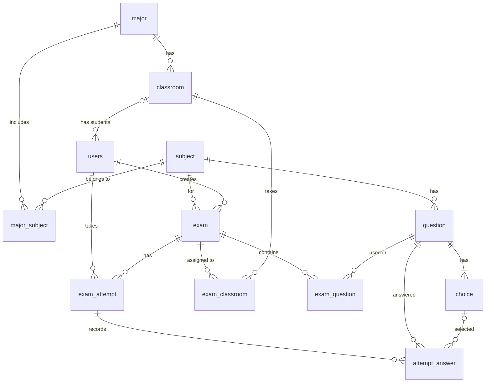

# Online Exam Platform

Hệ thống thi trắc nghiệm trực tuyến: ngân hàng câu hỏi, sinh đề ngẫu nhiên, làm bài có tính giờ, chấm điểm tự động và thống kê kết quả, phân quyền 3 vai trò (Admin, Giảng viên, Sinh viên).


## Mục lục

- [Tính năng](#tính-năng)
- [Công nghệ](#công-nghệ)
- [Thiết kế cơ sở dữ liệu](#thiết-kế-cơ-sở-dữ-liệu)
- [Quy tắc nghiệp vụ](#quy-tắc-nghiệp-vụ)
- [Quyết định thiết kế](#quyết-định-thiết-kế)
- [Cấu trúc dự án](#cấu-trúc-dự-án)
- [Hướng dẫn chạy](#hướng-dẫn-chạy)
- [Quy ước đặt tên](#quy-ước-đặt-tên)
- [Tác giả](#tác-giả)

## Tính năng

**Admin**
- Quản lý tài khoản (tạo, sửa, vô hiệu hóa), lớp, ngành, môn học
- Gán sinh viên vào lớp, gán môn học vào ngành

**Giảng viên**
- Quản lý ngân hàng câu hỏi và đáp án (dùng chung cho mọi giảng viên), tìm kiếm, lọc theo môn, phân trang
- Tạo kỳ thi: chọn môn, số câu, thời lượng, khung giờ mở thi, giao cho lớp
- Sinh đề ngẫu nhiên từ ngân hàng câu hỏi
- Xem kết quả và thống kê điểm theo kỳ thi

**Sinh viên**
- Xem danh sách kỳ thi được phép làm
- Làm bài có đồng hồ đếm ngược, tự lưu đáp án, xáo trộn thứ tự câu hỏi và đáp án
- Nộp bài, nhận điểm ngay, xem lịch sử thi

## Công nghệ

| Thành phần | Công nghệ |
|---|---|
| Ngôn ngữ | Java 21 |
| Framework | Spring Boot 4.1 (Spring MVC, Spring Data JPA, Validation) |
| Giao diện | Thymeleaf, Bootstrap 5, JavaScript |
| Cơ sở dữ liệu | MySQL 8.0.16 trở lên |
| Bảo mật | Spring Security (kế hoạch) |
| Công cụ | Maven (Maven Wrapper), Lombok, Git |

## Thiết kế cơ sở dữ liệu

Cơ sở dữ liệu gồm **12 bảng**. Script tạo bảng nằm ở [`database/script_schema.sql`](database/script_schema.sql).



| Bảng | Mô tả |
|---|---|
| `users` | Tài khoản, vai trò (`ADMIN`, `LECTURER`, `STUDENT`), trạng thái hoạt động |
| `classroom` | Lớp học, thuộc một ngành |
| `major` | Ngành học |
| `subject` | Môn học |
| `major_subject` | Bảng nối n-n giữa ngành và môn học |
| `question` | Ngân hàng câu hỏi, thuộc một môn |
| `choice` | Các đáp án của câu hỏi, có cờ `is_correct` |
| `exam` | Kỳ thi: môn, khung giờ mở thi, thời lượng làm bài |
| `exam_classroom` | Bảng nối n-n giữa kỳ thi và lớp được phép thi |
| `exam_question` | Các câu hỏi của kỳ thi và thứ tự câu |
| `exam_attempt` | Lượt làm bài của sinh viên: giờ bắt đầu, hạn nộp, trạng thái, điểm |
| `attempt_answer` | Đáp án sinh viên đã chọn cho từng câu trong một lượt làm bài |

## Quy tắc nghiệp vụ

1. Mỗi câu hỏi có **đúng một** đáp án đúng. Khi sửa câu hỏi thì cập nhật đáp án tại chỗ, không xóa rồi tạo lại.
2. Mỗi sinh viên chỉ có **một lượt làm bài** cho mỗi kỳ thi. Điểm theo thang 10.
3. Kỳ thi chỉ chứa câu hỏi **cùng môn** với kỳ thi.
4. Đáp án được chọn phải thuộc đúng câu hỏi, và câu hỏi được trả lời phải thuộc kỳ thi của lượt làm bài.
5. Hạn nộp (`deadline_at`) bằng giờ bắt đầu cộng thời lượng làm bài, nhưng không vượt quá giờ kết thúc kỳ thi (`end_time`).
6. Sinh viên chỉ vào thi được khi lớp của mình được giao kỳ thi và thời điểm hiện tại nằm trong khung giờ mở thi.
7. Sinh viên phải thuộc một lớp. Tài khoản **không bị xóa thật** mà chỉ bị vô hiệu hóa (`is_active`); tài khoản bị vô hiệu hóa không đăng nhập được.
8. Câu hỏi đã nằm trong kỳ thi thì không được xóa. Câu hỏi đã có lượt làm bài thì không được sửa nội dung và đáp án.
9. Mọi giảng viên dùng chung ngân hàng câu hỏi.

## Quyết định thiết kế

- **Database-first:** thiết kế ERD và tạo bảng bằng script SQL để kiểm soát ràng buộc (CHECK, khóa duy nhất ghép, `ON DELETE`) và dữ liệu mẫu. Hibernate chỉ ánh xạ và kiểm tra bằng `spring.jpa.hibernate.ddl-auto=validate`.
- **Server là nguồn thời gian duy nhất:** giờ bắt đầu và hạn nộp do server tính và lưu; đồng hồ JavaScript chỉ để hiển thị, server kiểm tra lại khi nhận bài nộp.
- **Xáo trộn ổn định:** thứ tự câu hỏi và đáp án được xáo bằng mã lượt làm bài làm hạt giống, nên tải lại trang không làm đổi thứ tự.
- **Phân tầng rõ ràng:** Controller, Service, Repository, Entity; Controller không trả trực tiếp Entity.
- **Vai trò và trạng thái là enum** lưu dạng chữ; tài khoản được vô hiệu hóa thay vì xóa để giữ lịch sử điểm.

## Cấu trúc dự án

```text
online-exam-platform
├── database
│   └── script_schema.sql        # Tạo database và toàn bộ bảng
├── src
│   ├── main
│   │   ├── java/com/onlineexam/platform
│   │   │   ├── controller       # Nhận request, trả view
│   │   │   ├── service          # Nghiệp vụ (interface + implement)
│   │   │   ├── repository       # Spring Data JPA
│   │   │   ├── entity           # Ánh xạ bảng
│   │   │   └── OnlineExamPlatformApplication.java
│   │   └── resources
│   │       ├── templates        # Giao diện Thymeleaf
│   │       ├── application.properties
│   │       └── application-example.properties
│   └── test
├── pom.xml
└── README.md
```

## Hướng dẫn chạy

### Yêu cầu

- JDK 21
- MySQL 8.0.16 trở lên (cần từ phiên bản này để ràng buộc CHECK có hiệu lực)
- Git (Maven không cần cài riêng vì dự án có sẵn Maven Wrapper)

### Các bước

**1. Clone dự án**

```bash
git clone https://github.com/HuuTho021205/online-exam-platform.git
cd online-exam-platform
```

**2. Tạo cơ sở dữ liệu**

Chạy file `database/script_schema.sql` bằng MySQL Workbench hoặc dòng lệnh:

```bash
mysql -u root -p < database/script_schema.sql
```

> Script sẽ **xóa và tạo lại** toàn bộ bảng, chỉ dùng cho môi trường phát triển.

**3. Cấu hình kết nối**

Sao chép file mẫu thành file cấu hình riêng (file này đã nằm trong `.gitignore`, không bị commit):

```bash
cp src/main/resources/application-example.properties src/main/resources/application-local.properties
```

Mở `application-local.properties` và điền tài khoản MySQL của bạn:

```properties
spring.datasource.username=root
spring.datasource.password=your_password
```

Lưu ý múi giờ trong URL kết nối phải là `Asia/Ho_Chi_Minh`.

**4. Chạy ứng dụng**

```bash
# Windows (PowerShell)
.\mvnw spring-boot:run

# macOS / Linux
./mvnw spring-boot:run
```

Mở trình duyệt tại [http://localhost:8080/subjects](http://localhost:8080/subjects).

### Chạy kiểm thử

```bash
.\mvnw test
```

Test `contextLoads` cần MySQL đang chạy và cấu hình `application-local.properties` đúng.

### Tài khoản demo

Sẽ được bổ sung cùng dữ liệu mẫu khi hoàn thành chức năng đăng nhập.

## Quy ước đặt tên

Toàn bộ tên Entity, bảng, cột, URL và API dùng **tiếng Anh**; nội dung hiển thị cho người dùng dùng tiếng Việt.

| Thuật ngữ | Tên trong code |
|---|---|
| Người dùng | `User` (bảng `users`) |
| Vai trò | `UserRole` (`ADMIN`, `LECTURER`, `STUDENT`) |
| Lớp | `Classroom` |
| Ngành | `Major` |
| Môn học | `Subject` |
| Câu hỏi | `Question` |
| Đáp án của câu hỏi | `Choice` |
| Kỳ thi | `Exam` |
| Câu hỏi trong kỳ thi | `ExamQuestion` |
| Lượt làm bài của sinh viên | `ExamAttempt` |
| Câu trả lời của sinh viên | `AttemptAnswer` |

| Đối tượng | Quy ước | Ví dụ |
|---|---|---|
| Lớp Java | PascalCase | `ExamAttempt` |
| Biến, phương thức | camelCase | `deadlineAt` |
| Bảng, cột | snake_case, chữ thường | `exam_attempt`, `started_at` |
| URL trang | kebab-case, danh từ số nhiều, tiền tố theo vai trò | `/admin/users`, `/student/exams` |
| API JSON | tiền tố `/api`, danh từ số nhiều | `/api/attempts/{id}/answers` |


## Tác giả

**HuuTho021205**: [github.com/HuuTho021205](https://github.com/HuuTho021205)